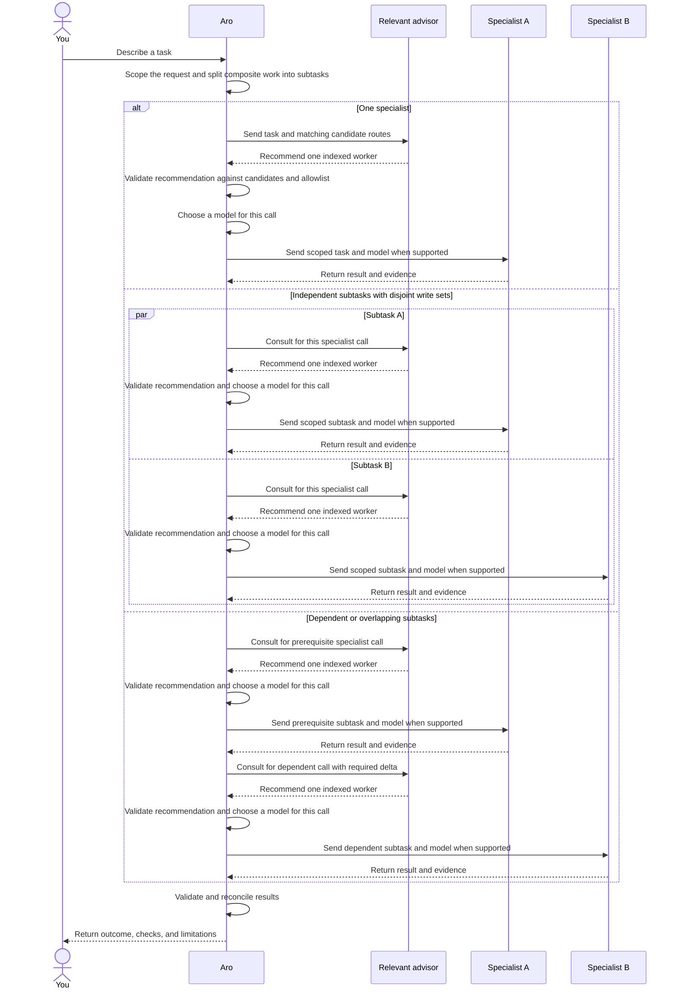

# Agent Roster for Copilot Chat

**Tell Copilot what you need. Aro finds the right specialist.**

<p align="center">
	
</p>

This extension adds 49 focused helpers to GitHub Copilot Chat. They can help explain a project, solve coding problems, plan changes, improve documentation, and more. Aro is the starting point: describe your task in your own words, and it brings in a helper suited to the work.

## Availability

This extension is not currently listed in the VS Code Marketplace, so there is no Store install link yet.

## Get Started

You’ll need VS Code 1.111 or newer and access to GitHub Copilot Chat with agent support.

Once the extension is available in your VS Code, open Copilot Chat, choose **Aro**, and describe what you need. For example:

```text
I’m new to this project. Explain what it does and where I should start.
```

Or:

```text
Please make this document easier for a non-technical reader to understand.
```

You can ask Aro to make a plan before changing anything. Review suggestions and approve changes through the usual Copilot prompts.

## Agents

The roster includes 49 specialists. Start with Aro: describe what you need, and Aro selects a relevant specialist.

**[View all 49 agents](docs/agents.md)**

- Understand a project or a piece of code
- Find and fix software problems
- Plan or review a change
- Improve documentation
- Get help with architecture, business processes, and infrastructure

<details>
<summary>How Aro routes a request</summary>

Aro consults the relevant advisor before every specialist call, even when the right specialist seems obvious.



If an advisor cannot recommend a valid worker, Aro corrects the candidate scope or asks for clarification; it does not skip advisor selection. Model choice is per call: use Claude Haiku 5.5 for clear, bounded, low-risk work and Claude Sonnet 5.5 for materially complex synthesis or design only when exact per-call IDs are available. If model selection is unsupported or rejected, use the configured model or runtime default and report the limitation. Report requested and resolved models separately; claim resolution only when runtime telemetry confirms it.

</details>

## Skills

The extension also includes 10 reusable guides for common tasks, such as investigating a problem, improving an interface, preparing a release, or writing technical documents.

**[View all 10 skills](docs/skills.md)**

## Privacy And Permissions

The extension does not install extra tools or grant itself access. Helpers use the tools already available in your Copilot Chat, and some tasks may ask to use them. Review proposed changes and permission prompts before approving them.

## License

This project is available under the [PolyForm Noncommercial License 1.0.0](LICENSE). It permits noncommercial use; commercial use requires separate permission from the rights holder. See the license for full terms.

For project maintenance and contributor information, see [maintenance](docs/maintenance.md).